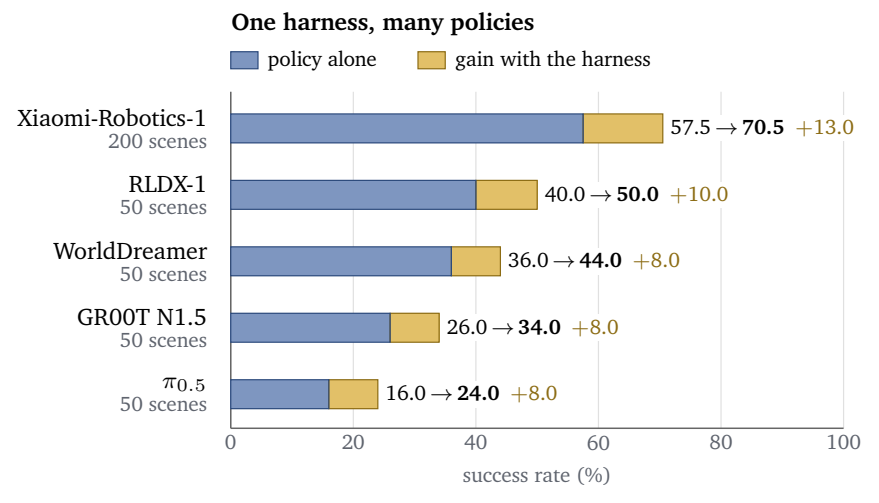

# RoboHarness-Zero

*Any Frozen VLA, Zero Per-Task Preparation*

[Contributions](#contributions) · [Results](#robocasa365-results) · [Verify the results](#verify-the-results) · [Installation](docs/policy-setup.md) · [Evaluation protocol](evaluations/robocasa365/2.0/README.md)

RoboHarness-Zero lets a frozen vision-language-action policy (VLA) control the robot while a vision-language model (VLM) watches its progress. If the robot stalls or acts on the wrong object, the supervisor can clarify the instruction, briefly guide the motion when needed, and hand control back.

On **200 paired RoboCasa365 scenes**, GPT-6 Astra supervision raised Xiaomi-Robotics-1’s success rate from **57.5% to 70.5%**. This repository contains the Xiaomi implementation and the evaluation records for all 200 scenes.



*The paper evaluates Xiaomi on 200 scenes. The other four policies share a 50-scene subset with one scene per task. Gold shows the gain from supervision in percentage points.*

## Contributions

- **Supervision without task-specific preparation.** New tasks need no demonstrations or task scripts. For a new frozen policy, a native adapter connects it to the supervisor, and automatic profiling measures how reliably and how quickly it performs each skill.
- **A paired protocol for measuring retention and rescue.** Comparing supervised and standalone runs on the same scene shows which successes the harness preserves and which failures it rescues. A separate control reissues the original instruction every 160 steps without a VLM.
- **The same rules improved five frozen policies.** On Xiaomi, the harness retained 104 of 115 standalone successes (90.4%) and rescued 37 of 85 failures (43.5%). On the shared 50-scene subset, RLDX-1 gained 10 percentage points, and WorldDreamer, GR00T N1.5, and π0.5 each gained 8.

## RoboCasa365 results

Each of the 50 tasks contributes four scenes. The standalone and supervised runs in each pair share the initial simulator state, policy randomness, and step budget. RoboCasa’s native success check scores the episode.

| Task split | Xiaomi alone | Xiaomi + harness | Net gain |
| --- | ---: | ---: | ---: |
| Atomic-Seen | 59/72 | 62/72 | +3 scenes |
| Composite-Seen | 35/64 | 45/64 | +10 scenes |
| Composite-Unseen | 21/64 | 34/64 | +13 scenes |
| **Overall** | **115/200 (57.5%)** | **141/200 (70.5%)** | **+26 scenes** |

The VLA generated every motor action in 22 of the 37 rescued scenes. Composite tasks account for 23 of the 26 net additional successes.

**Scoring note.** Ten scenes that initially timed out during planning were rerun with a 600-second nested-planning timeout in place of the 180-second default. Two changed to success, bringing the total from 139/200 to 141/200. These are author-run results. The full leaderboard workload uses 2,500 rollouts. The report lists the original attempts, timeout overrides, and the excluded `followup03` batch. [Result report](results/2.0-selected200/REPORT.md)

### Verify the results

From the repository root on macOS or Linux with Python 3.11 or newer, run

```bash
python3 tools/verify_results.py
```

The verifier checks the hashes of the original records and recomputes the supervised counts by split. Expect **141 successes and 59 failures across 200 unique scenes**. This runs offline on CPU without a simulator, checkpoint, or API key.

## How supervision works

Suppose the robot is asked to put a tool for peeling a cucumber on a cutting board. Reaching the utensil drawer completes the approach. It still needs to grasp the peeler.

1. **Let the policy act.** The VLA receives the full instruction by default. At checkpoints, the VLM uses left, right, and wrist camera views and robot state to check progress on the current step.
2. **Clarify the target.** If the grasp stalls, the supervisor can identify the green-handled peeler in a revised instruction. The VLA still chooses how to reach and grasp it.
3. **Correct the motion, then hand back control.** If the robot picks up the knife, the supervisor can briefly guide the gripper to the peeler, check the result, and return control to the VLA. Recovery motions use the same episode step budget.

## Run a new evaluation

The runtime targets Linux x86_64 with an NVIDIA GPU and EGL. Start with the installation guide for the pinned Xiaomi checkpoint, simulation assets, and separate coordinator, simulator, and policy environments. The planner guide describes the compatible API and the historical `gpt-6-astra` settings. [Installation](docs/policy-setup.md) · [Planner API](evaluations/robocasa365/2.0/PLANNER.md)

The API endpoint and key are supplied separately through `OPENAI_BASE_URL` and `OPENAI_API_KEY`.

To preview the reviewer workload, run

```bash
python3 tools/run_robocasa_submission.py \
  --runtime-prefix /path/to/harness-2.0-runtime \
  --output-dir /path/to/new-evaluation
```

The default command prints the plan without starting an episode. Exact replay of the historical trajectories additionally requires the original saved simulator states and policy RNG records, which are held outside this repository. [Evaluation guide](evaluations/robocasa365/2.0/README.md)

## Project metadata

| Field | Details |
| --- | --- |
| Team / submitter | Polyadic Research Group |
| Contact | [123090492@link.cuhk.edu.cn](mailto:123090492@link.cuhk.edu.cn) |
| Paper title | RoboHarness-Zero: Any Frozen VLA, Zero Per-Task Preparation |
| Authors | Yihao Shen, Yuxuan Chen, Xuantong Liu, Jun Gao, Weijian Luo, Tianyang Hu |
| Public repository | [polyadic-research/roboharness0](https://github.com/polyadic-research/roboharness0) |

[BibTeX citation](CITATION.bib)

## Source and license

This release packages the RoboCasa365 / Xiaomi implementation recorded as Harness 2.0. The evaluated source is version `1.2.3.5`, commit `c8911c64`. It builds on [RPent](https://github.com/RLinf/RPent). Project source is licensed under Apache 2.0. Model weights and simulation assets retain their upstream terms. [Source provenance](SOURCE_PROVENANCE.json) · [License](LICENSE) · [Third-party notices](THIRD_PARTY_NOTICES.md)
