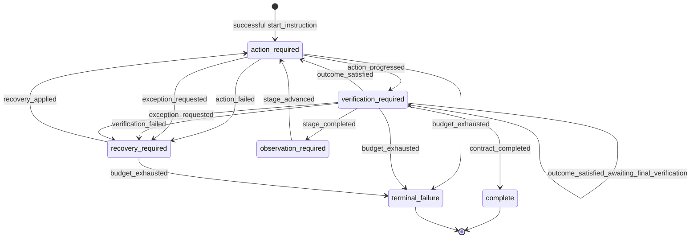

<!-- GENERATED FILE: edit rpent/harness/lifecycle.py instead. -->

# Harness Lifecycle Reference

This file is generated from `rpent/harness/lifecycle.py`, the single
source of truth for the ChatGPT-visible lifecycle.

## Planning granularity and step attempt budget

Use the smallest number of auditable skill-level steps needed for the goal. An atomic task may use a single complete-operation step when the selected tool can execute that operation. Add steps for distinct dependencies, independently verifiable outcomes, or different necessary tool operations. Do not split one reliable operation into approach, close, lift, or waypoint steps merely to reach a step-count target. Preserve every requested outcome and prerequisite, and never exceed 16 steps.

max_attempts is the total physical tool-call budget while a step is active, including progress calls and retries; it is not just a retry count. A completed zero-action pre-close review pause consumes no attempt, but still requires verification before another physical action. Calls that execute any action or fail still count. Count every physical call needed for the expected sequence except this review-only pause, and preserve one additional attempt only when a safe retry is justified. Reaching max_attempts returns control for replanning or recovery; by itself it never ends the episode.

Only completed policy-tool calls paused for pre-close, pre-release or semantic target review
with consistent zero-execution and cancelled-action counters receive
the attempt exemption. Verification remains pending; no outcome is
completed and no physical continuation is authorized by the pause.

## Bounded takeover finishing reserve

At a takeover quota boundary, the program may grant a short finishing lease after two consecutive physically executed, verified progress calls with measured arm movement toward their endpoints and stable retained-load width. Holding still or an unsupported progress verdict cannot qualify. Each lease allows at most 50 actions and two physical calls; all calls still require fresh verification. Only bounded pose/gripper primitives are allowed: no base travel, policy action, multiphase macro or new grasp. All calls still require verification. Only the current operation may spend its shared reserve, at most 200 actions and always leaving at least 50 actions for policy fallback. The configured original episode horizon remains binding. An observed stable commanded release after qualifying transport can retain one final withdrawal lease; it never authorizes a new acquisition. Unexpected loss, unstable width, semantic conflict or a physical call without verified measured progress ends a finishing lease and returns to the existing monitor fallback. Replanning and split subtasks cannot replenish the same operation's borrowed reserve. No lease establishes object support, retention or task success: inspect fresh public evidence and retain all existing outcome and recovery authority.

## Episode liveness and verified retries

Each RoboCasa episode has an independent liveness budget: 500 observable API model requests across execution and nested planning, or 90 minutes of wall time, whichever is reached first. Native SDK provider requests are opaque and use the wall-time ceiling. Exhaustion ends the run as FAILED without claiming environment success or fabricating a finish. After two consecutive rejected pre-close reviews in the same closure cycle, the next policy close is permitted without claiming visual approval; direct closure still requires approval. Resolve pending verification first. After a verified retry, either use its bounded same-step retry or request a replan directly; do not verify the already resolved execution again.

## First VLA failure and LLM takeover

Observation, semantic replanning and direct motor takeover are separate. Two explicitly typed, verified physical VLA failures permit bounded takeover; they never require it while fresh evidence supports native continuation. One observed destructive failure or explicit wrong-target/destination/allocation conflict may permit bounded recovery immediately. Uncertainty, missing effect, a false task predicate, allocation timeout, guard pause or rejected/zero-action call alone never establishes a physical failure. Resolve pending verification before any recovery. Preserve original outcomes, budgets and success authority.

## Explicit task-target conflict review

During protected whole-task policy-first execution, task-action conflict evidence may permit bounded recovery, but a release watch or speculative alignment judgment cannot interrupt the native stream. An uncertain or merely incomplete current phase permits only semantic policy review. Keep normal delegation and retry thresholds. On fresh, explicit evidence of a wrong object, destination or quantity/container assignment, call review_task_action(verdict=conflict) with expected_step, phase, conflict_type, expected_target, observed_target and evidence. This pauses policy execution and offers bounded correction immediately, even before any physical failure. Resolve pending verification before physical correction; use the existing replan/recovery protocol and unchanged operation identity and budgets. Correct only the conflicting action, then observe and review aligned before handing back to the policy. Clear semantic errors never count as progress. Occlusion, uncertain alignment, slow productive contact and historical rates alone are not semantic conflicts. For a placement whose original goal has multiple distinguishable containers or per-container quantities, arm a release watch with review_task_action(phase=release, verdict=watch) before continuing transport. It pauses immediately before opening; observe and review aligned, conflict or uncertain at that pose. Aligned release approval is local and consumed by one release. Do not arm watches for ordinary unambiguous placements. A semantic veto is independent of the two rejected alignment reviews that allow a policy close; neither rejection counts nor replanning can erase it. Reviews are public-evidence judgments, never hidden predicate truth or success authority.

## Legacy environment-horizon completion review

When completion_review.required=true, all local steps passed but native environment success is still false. Call observe again after the last local acceptance, then call replan with its completion_review.observation_id as review_observation_id and completed_step_reviews covering every listed fact_id exactly once. For each historical acceptance, inspect its original expected_evidence and current public evidence; report confirmed, needs_repair, or uncertain with concrete evidence. Check all original task targets, quantities, container assignments, supported release, placement and posture constraints, not just the last action. A prior pass is historical evidence, not an irrevocable fact. Repair earlier work contradicted by fresh evidence; unknown or occluded conditions remain uncertain. Preserve confirmed progress and target identity. If every local result is confirmed, inspect the original goal for omitted conditions rather than repeating the final action. These reviews cannot authorize finish(success) or expose hidden predicate truth.

This read-only gate uses the existing plan/replan mode. It does not add
a strict HarnessSession state, predicate authority, or recovery scope.

## Bootstrap boundary

`start_instruction` is a one-shot pre-lifecycle bootstrap. The session is
unstarted (`None`) until successful plan registration assigns the initial
`action_required` state. It is not an allowed lifecycle operation and is
rejected after the session has started.

## States and allowed operations

| State | Terminal | Allowed operations |
|---|---:|---|
| `action_required` | no | `configured_physical_tool`, `request_exception`, `execution_status` |
| `verification_required` | no | `verify_step`, `verify_observation`, `submit_observation`, `verify_outcomes`, `execution_status` |
| `observation_required` | no | `submit_observation`, `execution_status` |
| `recovery_required` | no | `apply_recovery`, `execution_status` |
| `complete` | yes | `finish`, `execution_status` |
| `terminal_failure` | yes | `finish`, `execution_status` |

## Conditional recovery guard

After a non-terminal `apply_recovery` consumes a recovery scope,
`action_required` must attempt a configured physical operation before
another `request_exception` can consume a higher recovery scope. While
that action is pending, the allowed operations are: `configured_physical_tool`, `execution_status`.

## Legal transitions

| Source | Event | Target |
|---|---|---|
| `action_required` | `action_progressed` | `verification_required` |
| `action_required` | `action_failed` | `recovery_required` |
| `action_required` | `exception_requested` | `recovery_required` |
| `action_required` | `budget_exhausted` | `terminal_failure` |
| `verification_required` | `verification_uncertain` | `verification_required` |
| `verification_required` | `outcome_satisfied_awaiting_final_verification` | `verification_required` |
| `verification_required` | `outcome_satisfied` | `action_required` |
| `verification_required` | `stage_completed` | `observation_required` |
| `verification_required` | `contract_completed` | `complete` |
| `verification_required` | `verification_failed` | `recovery_required` |
| `verification_required` | `exception_requested` | `recovery_required` |
| `verification_required` | `budget_exhausted` | `terminal_failure` |
| `observation_required` | `stage_advanced` | `action_required` |
| `recovery_required` | `recovery_applied` | `action_required` |
| `recovery_required` | `budget_exhausted` | `terminal_failure` |

## Diagram

